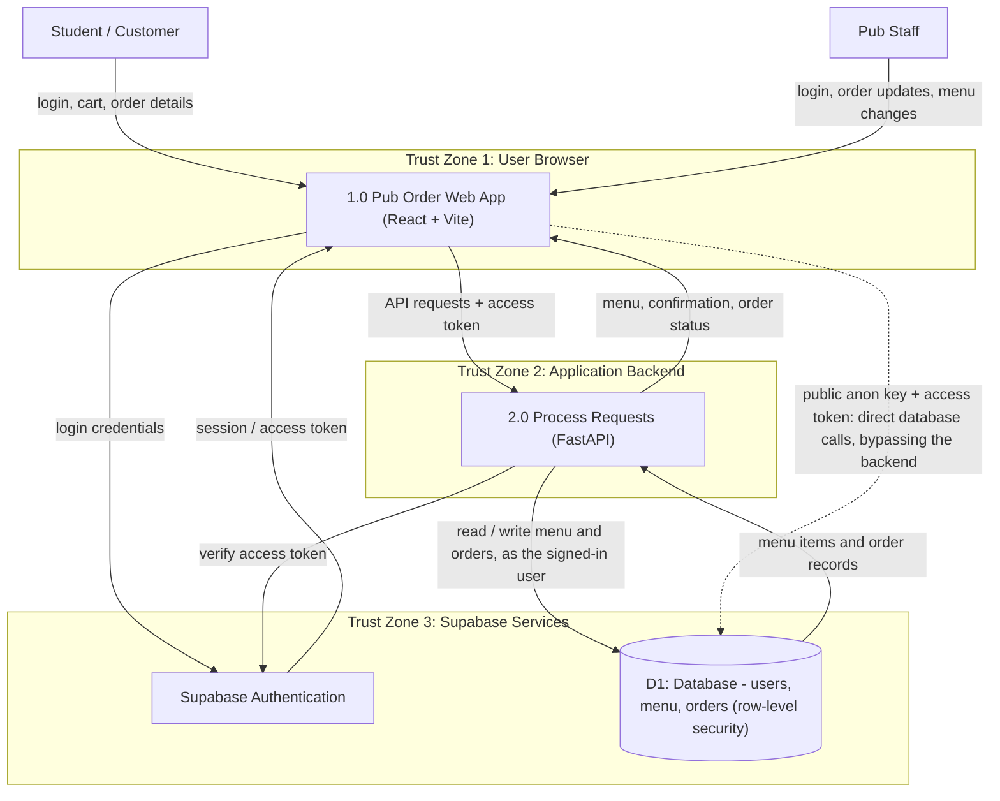

# Threat model -- Pub-Order (Group 5)   (docs/security/threat-model.md)
Last updated: 2026-11-03 · Authors: Hamayun Raza (diagrammer, STRIDE lead), Brink Wiesedeppe (defender, scribe), Luke Anderson, Ibrahim Boudaoud · Covers: main @ `12b0d43` + staging: none yet (the app runs locally or from the release artifact, against the hosted Supabase project)

## 1. Data-flow diagram (DFD)
Converted from the in-class DFD. Each subgraph is a trust zone; every arrow between zones crosses a trust boundary. Pub-Order has no LLM, payment or email provider, so the only third party is Supabase.

### Trust boundaries
| Trust boundary (A -> B) | Data crossing it | Who controls each side? |
|-------------------------|------------------|-------------------------|
| Student & Staff -> React Frontend | Login information, menu selections, cart and customizations | The user controls what they enter; our team controls the React app |
| React Frontend -> FastAPI Backend | Order requests, checkout reviews, the access token | The user controls what requests are sent; our team controls the backend logic |
| React Frontend -> Supabase | Login credentials going in; session and access tokens coming back. The public anon key also lets the browser call the database directly | The user sends the credentials; Supabase handles authentication for us |
| FastAPI Backend -> Supabase | Token checks (Auth), and menu items, orders and order statuses (database), sent as the signed-in user | Our team controls the backend logic and the database rules (migrations); Supabase hosts both services |
| Staff Frontend -> Admin Functions | Staff sign-in, order status changes and sold-out changes (`PATCH /orders/{id}`, `PATCH /menu/{id}`) | Staff control what they submit; the backend checks the kitchen role (`require_kitchen`) and the database checks it again (`is_kitchen()`) |

## 2. Assets (what an attacker wants)
| Asset | Where it lives | Why it matters | Impact if lost or changed |
|-------|----------------|----------------|---------------------------|
| Student accounts / sessions | Supabase Auth; session tokens in the browser's localStorage | Whoever holds a session can place and read that student's orders | M |
| Kitchen role | `profiles.role` in Postgres; the shared `kitchen@puborder.test` account | Sees every order, changes any order's status, marks items sold out | H |
| Order history | `orders`, `order_items` in Postgres | What each student ordered and when; tampering confuses pickup | M |
| Menu availability | `menu_items.available` in Postgres | Marking items sold out stops students ordering them | L |
| Supabase service-role key | Supabase dashboard only. It must never go in `.env`: `SUPABASE_KEY` is the public anon key | Bypasses all row-level security: full control of the database | H |
| Release artifact creation | GitHub Actions | A tampered build would ship to whoever runs the release | M |

There is no payment data, LLM budget or real meal-plan balance in the system.

## 3. STRIDE table (at least 8 rows, across at least 3 boundaries)
| # | Boundary (A -> B) | STRIDE | Asset | Threat (one sentence) | Existing control | Gap? -> Finding ID |
|---|-------------------|--------|-------|-----------------------|------------------|--------------------|
| T1 | Student & Staff -> React Frontend | S | Student accounts | Someone signs up with another student's email (or any email) and orders as them, because the hosted project doesn't confirm emails or limit sign-up to Vanderbilt addresses. | Supabase Auth handles passwords and sessions; sign-up accepts any address | Yes -> SEC-02 |
| T2 | React Frontend -> FastAPI Backend | S | Student accounts | Someone sends a forged or expired access token to impersonate a user. | Every route that needs a user checks the token with Supabase (`get_current_user`); only `GET /menu` is public. Tested: `test_token_with_tampered_signature_is_rejected` | No |
| T3 | React Frontend -> FastAPI Backend | T | Order history | A user edits the request to change quantities, the number of meal swipes or an item's meal type (the app has no prices; orders are paid in swipes). | The backend re-checks every item, quantity and swipe type against the database (`review_cart`), and `place_order` checks again inside the database. Tested in `test_orders.py`, `test_menu_checkout.py` | No |
| T4 | React Frontend -> FastAPI Backend | R | Order history | A student denies placing an order. | Each order stores the signed-in user's id and `created_at`, both set by the database from the token, never from the request | No |
| T5 | React Frontend -> FastAPI Backend | I | Order history | A student changes the order ID in a request to view another student's order. | Row-level security shows students only their own orders, and the API answers 404. Tested: `test_another_student_cannot_track_the_order` | No |
| T6 | Staff Frontend -> Admin Functions | E | Kitchen role | A student calls the kitchen routes directly to change an order's status or mark an item sold out. | `require_kitchen` in the backend and `is_kitchen()` in the database functions. Tested: `test_a_student_cannot_change_an_order_status`, `roles.sql` | No |
| T7 | React Frontend -> Supabase | E | Kitchen role | The sign-up trigger makes whoever registers `kitchen@puborder.test` kitchen staff, so on any project where that account doesn't exist yet (a new staging deploy, or after it is deleted) the first person to register it gets full staff access. | Roles can only be changed inside the database; students can't edit `profiles` | Yes -> SEC-01 |
| T8 | Staff Frontend -> Admin Functions | R | Order history, menu availability | A staff member denies changing an order's status or marking an item sold out, and we can't show who did it: the kitchen login is shared and only `updated_at` is stored. | `updated_at` timestamp only | Yes -> SEC-04 |
| T9 | React Frontend -> FastAPI Backend | D | Order history | A signed-in script places hundreds of valid orders and floods the kitchen queue, since nothing limits orders per student or per minute. | Each order is capped at 10 swipes; nothing else | Yes -> SEC-03 |
| T10 | React Frontend -> Supabase | T | Order history | A student calls `place_order` directly with the public anon key, skipping the backend's checkout review and its customization allow-list, and sends free-text "customizations" to the kitchen. | `place_order` re-checks items, quantities and the meal rule; customization is cut to 200 characters; React escapes it on screen | Yes -> SEC-06 |
| T11 | Student & Staff -> React Frontend | I | Student accounts / sessions | A script injected into the page could read session tokens from localStorage and take over the account. | React escapes all output; no `dangerouslySetInnerHTML`, `innerHTML` or `eval`; but no Content-Security-Policy or other security headers | Yes -> SEC-05 |
| T12 | FastAPI Backend -> Supabase | I | Database details | A database or network error leaks table names or connection details in an API response. | Every database error becomes a short 503 message. Tested: `test_database_failures_are_sanitized` | No |
| T13 | GitHub Actions -> release artifact | T | Release artifact creation | A compromised third-party action changes the build, because actions are pinned to version tags, not commit SHAs. | Python packages pinned with `==`, `package-lock.json` committed, no secrets in CI | Yes -> SEC-07 |

## 4. OWASP Top 10:2025 checklist -- owner per category
Owners as assigned in class. Results are filled in during the Sprint 4 manual review.

| Category | Owner | What we checked (where) | Result: pass / finding (ID) / N/A + reason |
|----------|-------|-------------------------|--------------------------------------------|
| A01 Broken Access Control (try changing an ID as another user) | Brink | Change order IDs as a second test student on every `/orders` route; call the kitchen routes and database functions as a student | To do |
| A02 Security Misconfiguration | Hamayun | CORS origins (`backend/app/main.py`), security headers (`backend/serve.py`), Supabase Auth settings, default accounts (`kitchen@puborder.test`) | To do |
| A03 Software Supply Chain Failures | Hamayun | Lock file committed, `pip-audit`, `npm audit --audit-level=high`, GitHub Actions pinning | To do |
| A04 Cryptographic Failures | Ibrahim | Password hashing (handled by Supabase Auth), HTTPS, secrets at rest (`.env` is gitignored) | To do |
| A05 Injection (SQL, XSS, command) | Luke | No string-built SQL (PostgREST and parameterized database functions), no raw HTML rendering, customization text | To do |
| A06 Insecure Design | Brink | Missing limits and abuse cases from STRIDE: order flooding (T9), direct `place_order` calls (T10) | To do |
| A07 Authentication Failures | Luke | Session expiry, password reset, sign-up and login rate limits, shared kitchen login | To do |
| A08 Software or Data Integrity Failures | Brink | CI secrets, GitHub Actions pinning, release built only from `main` and `sprint3*` tags | To do |
| A09 Security Logging & Alerting Failures | Ibrahim | Are failed logins and permission denials (401 / 403) logged? The backend has no logging today | To do |
| A10 Mishandling of Exceptional Conditions | Hamayun | `except Exception` blocks in `orders.py` and `menu.py`, the role lookup failing closed (`fetch_role`), error pages | To do |

## 5. Top 3 risks and next actions
1. **SEC-01: kitchen access is granted by email address (T7, High).** Remove the `kitchen@puborder.test` rule from the sign-up trigger, grant kitchen only by a database-side change, and add a regression test that registering that email gives a student account.
2. **SEC-02: sign-up doesn't verify who you are (T1, Medium).** Turn on email confirmation for the hosted project and limit sign-up to `@vanderbilt.edu`, with a test that another domain is refused.
3. **SEC-03: no limit on orders per student (T9, Medium).** Cap open orders per student inside `place_order` and rate-limit `POST /orders`, with a test that the extra order is refused.

Each is a GitHub issue labelled `security` in the Sprint 4 milestone.
